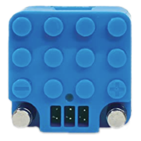

# Circuit Cubes

Circuit Cubes ist ein Bluetooth-LE-Motorcontroller in Würfelform, der bis zu drei Motoren ansteuert.

## Kanäle

Das Gerät stellt 3 Kanäle bereit:

| Kanäle | Zweck | Ausgabe |
|---|---|---|
| A - C | Motoren | -100 % bis +100 % |

## Erste Schritte

1. Schalte den Bluetooth-Würfel von Circuit Cubes ein.
2. Öffne die Geräteliste und tippe auf  **neue Geräte scannen**. Gefundene Geräte werden zur Liste hinzugefügt.
3. Verwende das Gerät in einer Kreation und weise seine Kanäle Steuerungsaktionen zu.

## Hinweise

- Bei der ersten Verwendung verbindet sich das Gerät nicht automatisch. Stelle die Verbindung über die Geräteseite oder durch Starten einer Kreation her, die es verwendet.
- Das Gerät meldet die Akkuspannung; sie wird auf der Geräteseite angezeigt.
- Nach jeder Änderung werden die Ausgabewerte eine kurze Zeit wiederholt gesendet, damit sie den Würfel sicher erreichen.

## Siehe auch

- [Geräte](../../pages/device-list/README.md)
- [Steuerungsaktion](../../pages/controller-action/README.md)
