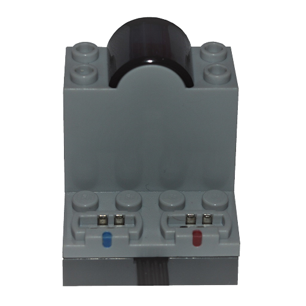

# LEGO Power Functions Infrarot

Das Infrarotgerät steuert LEGO-Power-Functions-Empfänger über den Infrarotsender des Telefons.

**Hinweis:** Infrarotgeräte werden nur unter Android und nur auf Telefonen mit Infrarotsender unterstützt. Sie können nicht gesucht werden und müssen manuell hinzugefügt werden.

## Kanäle

Das Gerät stellt 2 Kanäle bereit:

| Kanäle | Zweck | Ausgabe |
|---|---|---|
| 1 - 2 | Empfängerausgänge (Blau, Rot) | -100 % bis +100 % |

## Erste Schritte

1. Stelle sicher, dass dein Telefon einen Infrarotsender hat und der Empfänger eingeschaltet ist.
2. Öffne die Geräteliste, tippe auf  **Geräte manuell hinzufügen**, wähle das Infrarotgerät aus und übernimm die Änderungen.
3. Verwende das Gerät in einer Kreation und weise seine Kanäle Steuerungsaktionen zu.

## Siehe auch

- [Geräte](../../pages/device-list/README.md)
- [Steuerungsaktion](../../pages/controller-action/README.md)
