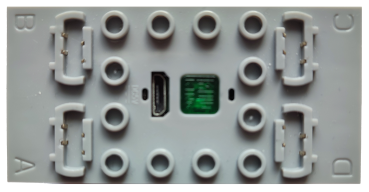

# Mould King - MK 4.0

**Mould King - MK 4.0** ist ein Bluetooth-Low-Energy-Modul (BLE), das bis zu vier Motoren ansteuert. Bis zu drei Module können gleichzeitig gesteuert werden.

## Kanäle

Jedes **Mould King - MK 4.0**-Modul stellt 4 Kanäle bereit:

| Kanäle | Zweck | Ausgabe |
|---|---|---|
| 1 - 4 | Anschlüsse A, B, C, D | -100 % bis +100 % |

## Erste Schritte

**Das Modul wird nicht durch die Suche gefunden.**

1. Öffne die Geräteliste, tippe auf  **Geräte manuell hinzufügen**.
2. Aktiviere in der Liste zum manuellen Hinzufügen **Mould King - MK 4.0 Gerät 1**. Für weitere Module verwendest du **Gerät 2** und **Gerät 3**. Tippe anschließend auf  **Änderungen übernehmen**.
3. Schalte das **Mould King - MK 4.0**-Modul ein. Nach dem Einschalten ist **Gerät 1** standardmäßig eingestellt; die LED blinkt einmal pro Zyklus. Ändere die Gerätenummer mit einem kurzen Druck auf die Gerätetaste. Für **Gerät 2** blinkt die LED zweimal pro Zyklus, für **Gerät 3** dreimal.
4. Verwende das Gerät in einer Kreation und weise seine Kanäle Steuerungsaktionen zu.

## Hinweise

- Es werden bis zu drei **Mould King - MK 4.0**-Module unterstützt. Sie verwenden alle denselben Bluetooth-Werbestrom.
- Die Ausgabe wird über Bluetooth-Werbenachrichten gesendet. Daher meldet das Modul weder einen Verbindungsstatus noch die Akkuspannung.
- Die Verbindungsnachricht wird erneut gesendet, nachdem alle Kanäle einige Sekunden lang auf null geblieben sind.

## Siehe auch

- [Geräte](../../pages/device-list/README.md)
- [Steuerungsaktion](../../pages/controller-action/README.md)
