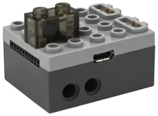

# PFx Brick

PFx Brick (FX Bricks) ist ein Bluetooth-LE-Baustein, der Power-Functions-Motoren und -Leuchten steuert und Töne abspielt.

## Kanäle

Das Gerät stellt 10 Kanäle bereit:

| Kanäle | Zweck | Ausgabe |
|---|---|---|
| A - B | Power-Functions-Motoren | -100 % bis +100 % |
| 1 - 8 | Leuchten | Helligkeit 0 bis 100 % |

## Erste Schritte

1. Schalte den PFx Brick ein.
2. Öffne die Geräteliste und tippe auf  **neue Geräte scannen**. Gefundene Geräte werden zur Liste hinzugefügt.
3. Verwende das Gerät in einer Kreation und weise seine Kanäle Steuerungsaktionen zu.

## Ton

Du kannst Ton über Makros steuern, die du Steuerungsaktionen zuweisen kannst:

- **Ton abspielen** startet eine auf dem Gerät gespeicherte Audiodatei.
- **Ton stoppen** beendet die Wiedergabe.
- **Ton umschalten** startet den Ton oder beendet ihn, falls er bereits läuft.
- **Lautstärke einstellen** legt eine bestimmte Lautstärke fest.
- **Lautstärke erhöhen** und **Lautstärke verringern** ändern die Lautstärke schrittweise.

## Skripte

Du kannst Skriptmakros Steuerungsaktionen zuweisen:

- **Skript ausführen** startet ein auf dem Gerät gespeichertes Skript.
- **Skript stoppen** beendet ein laufendes Skript.

## Einstellungen

- **Standardlautstärke**: Die Lautstärke nach dem Verbinden. Der Standardwert ist 50 %.

## Hinweise

- Bei der ersten Verwendung verbindet sich das Gerät nicht automatisch. Stelle die Verbindung über die Geräteseite oder durch Starten einer Kreation her, die es verwendet.
- Audiodateien und Skripte müssen auf dem PFx Brick gespeichert sein; die App startet sie lediglich.
- Audiodateien und Skripte verwaltest du mit der PFx-Brick-App, nicht mit dieser App.

## Siehe auch

- [Dokumentation von FX Bricks](https://shop.fxbricks.com/pages/documentation)
- [Steuerungsaktion](../../pages/controller-action/README.md)
