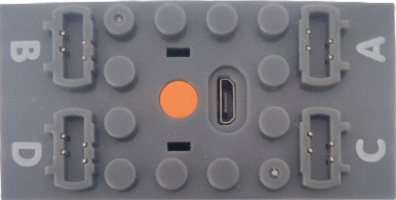

# PowerBox - A Series

**PowerBox - A Series** ist ein Bluetooth-Low-Energy-Modul (BLE), das bis zu vier Motoren ansteuert.

**Achtung:** Diese Geräte sind innerhalb derselben Kreation nicht miteinander kompatibel, da sie identische BLE-Werbenachrichten verwenden.

- [PowerBox - A Series](../powerboxaseries/README.md)
- [PowerBox - M Battery](../powerboxmbattery/README.md)
- [JIESTAR - SCM 4 Gerät 1](../jiestarscm4/README.md)

## Kanäle

Das **PowerBox - A Series**-Modul stellt 4 Kanäle bereit:

| Kanäle | Zweck | Ausgabe |
|---|---|---|
| 1 - 4 | Anschlüsse A, B, C, D | -100 % bis +100 % |

## Erste Schritte

**Das Modul wird nicht durch die Suche gefunden.**

1. Öffne die Geräteliste, tippe auf  **Geräte manuell hinzufügen**.
2. Aktiviere in der Liste zum manuellen Hinzufügen **PowerBox - A Series Gerät**. Tippe anschließend auf  **Änderungen übernehmen**.
3. Schalte das **PowerBox - A Series**-Modul ein.
4. Verwende das Gerät in einer Kreation und weise seine Kanäle Steuerungsaktionen zu.

## Hinweise

- Die Ausgabe wird über Bluetooth-Werbenachrichten gesendet. Daher meldet das Modul weder einen Verbindungsstatus noch die Akkuspannung.
- Die Verbindungsnachricht wird erneut gesendet, nachdem alle Kanäle einige Sekunden lang auf null geblieben sind.

## Siehe auch

- [Geräte](../../pages/device-list/README.md)
- [Steuerungsaktion](../../pages/controller-action/README.md)
