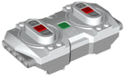

# LEGO Powered Up Fernbedienung

Die LEGO Powered Up Fernbedienung (88010) ist eine Bluetooth-LE-Fernbedienung ohne Ausgänge. Sie funktioniert stattdessen als Eingabegerät, dessen Tasten du Steuerungsaktionen zuweisen kannst.

## Tasten

| Taste | Beschreibung |
|---|---|
| A, B | Mittlere Tasten auf der linken (A) und rechten (B) Seite |
| A.Plus, A.Minus | Plus- und Minustaste auf der linken Seite |
| B.Plus, B.Minus | Plus- und Minustaste auf der rechten Seite |
| Home | Grüne Taste |

## Erste Schritte

1. Schalte die Fernbedienung mit ihrer grünen Taste ein.
2. Öffne die Geräteliste und tippe auf  **neue Geräte scannen**. Gefundene Geräte werden zur Liste hinzugefügt.
3. Öffne die Geräteseite und aktiviere die Fernbedienung. Standardmäßig ist sie deaktiviert.
4. Weise ihre Tasten Steuerungsaktionen zu.

## Hinweise

- Das Gerät hat keine Kanäle und kann daher in einer Kreation nicht als Ausgabegerät verwendet werden.

## Siehe auch

- [Geräte](../../pages/device-list/README.md)
- [Steuerungsaktion](../../pages/controller-action/README.md)
