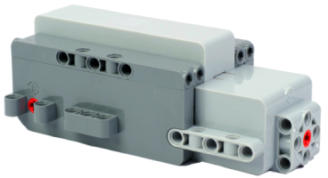

# LEGO Technic Move Hub

Der LEGO Technic Move Hub ist ein Bluetooth-LE-Hub mit drei Motoranschlüssen (A, B, C) und sechs Lichtausgängen.

## Kanäle

Das Gerät stellt 9 Kanäle bereit:

| Kanäle | Zweck | Ausgabe |
|---|---|---|
| 1 - 2 | Anschlüsse A, B | -100 % bis +100 % |
| 3 | Anschluss C (Motor oder Lenkservo) | -100 % bis +100 % |
| 4 - 9 | Leuchten 1 - 6 | 0 % bis 100 % |

## Erste Schritte

1. Schalte den Hub ein.
2. Öffne die Geräteliste und tippe auf  **neue Geräte scannen**. Gefundene Geräte werden zur Liste hinzugefügt.
3. Verwende das Gerät in einer Kreation und weise seine Kanäle Steuerungsaktionen zu.

## PLAYVM-Modus

Wenn der PLAYVM-Modus aktiviert ist, funktioniert Anschluss C als Lenkservo. Der virtuelle Kanal **AB** steuert die Anschlüsse A und B gemeinsam als Antriebsmotoren. Ist der Modus deaktiviert, funktioniert Anschluss C als normaler Motor.

## Einstellungen

- **PLAYVM-Modus**: Aktiviert das PLAYVM-Verhalten. Standardmäßig ist der Modus aktiviert.

## Siehe auch

- [Geräte](../../pages/device-list/README.md)
- [Steuerungsaktion](../../pages/controller-action/README.md)
