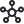

# Navigationsleiste

Die Hauptseiten teilen sich eine Navigationsleiste am unteren Bildschirmrand.

## Einträge

-  **Kreationen** – Deine Kreationen.
-  **Geräte** – Suche und verwalte deine Geräte.
-  **Sequenzen** – Verwalte wiederverwendbare Steuerungssequenzen.
-  **Mehr** – Öffnet ein Menü mit:
  -  **Eingabegeräte** – Teste verbundene Gamecontroller und Tastaturen.
  -  **Einstellungen** – Öffne die App-Einstellungen.
  -  **Hilfe** – Zeige die Hilfe der aktuellen Seite an.
  -  **Über** – Zeige Informationen zur App an.

## Siehe auch

- [Kreationen](../creation-list/README.md)
- [Geräte](../device-list/README.md)
- [Sequenzen](../sequence-list/README.md)
- [Eingabegerätetest](../input-device-tester/README.md)
