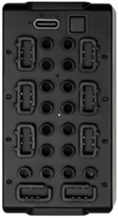

# JIESTAR - SCM 8

**JIESTAR - SCM 8** is a Bluetooth Low Energy (BLE) module that drives up to eight motors. Up to three modules can be controlled at the same time.

## Channels

Each **JIESTAR - SCM 8** module exposes 8 channels:

| Channels | Purpose | Output |
|---|---|---|
| 1 - 8 | Ports A, B, C, D, E, F, G, H | -100 % to +100 % |

## Getting started

⚠️ **The module is not discovered by scanning!** ⚠️

1. Open the device list and press  **Manually add devices**.
2. In the manual device list, switch on **JIESTAR - SCM 8 Device 1**. Use **Device 2** and **Device 3** for additional modules. Then tap  **Apply changes**.
3. Power on the **JIESTAR - SCM 8** module.
**Device 1** is the default instance number after power on, the LED blinks once per cycle.
Change the instance number by short-pressing the button on the device. The LED blinks twice per cycle for **Device 2** and three times per cycle for **Device 3**.
4. Use the device in a creation: assign its channels to controller actions.

## Notes

- Up to three **JIESTAR - SCM 8** modules are supported.
- Output is sent as Bluetooth advertising, so the module does not report a connection state or battery voltage.
- The connect telegram is sent again after all channels have stayed at zero for a few seconds.

## See also

- [Devices](../../pages/device-list/README.md)
- [Controller action](../../pages/controller-action/README.md)
