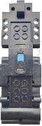

# Mould King - MK 3.0

**Mould King - MK 3.0** is a Bluetooth Low Energy (BLE) module featuring two integrated motors with LEGO-compatible cross-axle outputs.

## Channels

The **Mould King - MK 3.0** module exposes 4 channels:

| Channels | Purpose | Output |
|---|---|---|
| 1  | Axle left | -100 % to +100 % |
| 2  | Axle right | -100 % to +100 % |
| 3  | Internal Function 1 | OFF / ON |
| 4  | Internal Function 2 | OFF / ON |

## Getting started

⚠️ **The module is not discovered by scanning!** ⚠️

1. Open the device list to add the device manually.
2. In the manual device list, switch on **Mould King - MK 3.0 Device**.
3. Power on the **Mould King - MK 3.0** module.
4. Use the device in a creation: assign its channels to controller actions.

## Notes

- Output is sent as Bluetooth advertising, so the module does not report a connection state or battery voltage.
- The connect telegram is sent again after all channels have stayed at zero for a few seconds.

## See also

- [Devices](../../pages/device-list/README.md)
- [Controller action](../../pages/controller-action/README.md)
