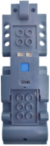

# Mould King - MK 3.8

**Mould King - MK 3.8** is a Bluetooth Low Energy (BLE) module featuring three integrated motors with LEGO-compatible cross-axle outputs and providing two electrical mini-plug connectors.

## Channels

The **Mould King - MK 3.8** module exposes 5 channels:

| Channels | Purpose | Output |
|---|---|---|
| 1  | Axle left | -100 % to +100 % |
| 2  | Plug 1 | -100 % to +100 % |
| 3  | Axle right | -100 % to +100 % |
| 4  | Plug 2 | -100 % to +100 % |
| 5  | Axle top | left / off / right |

## Getting started

⚠️ **The module is not discovered by scanning!** ⚠️

1. Open the device list and press  **Manually add devices**.
2. In the manual device list, switch on **Mould King - MK 3.8 Device**. Then tap  **Apply changes**.
3. Power on the **Mould King - MK 3.8** module.
4. Use the device in a creation: assign its channels to controller actions.

## Notes

- Output is sent as Bluetooth advertising, so the module does not report a connection state or battery voltage.
- The connect telegram is sent again after all channels have stayed at zero for a few seconds.

## See also

- [Devices](../../pages/device-list/README.md)
- [Controller action](../../pages/controller-action/README.md)
