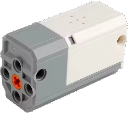

# PowerBox - M Battery

**PowerBox - M Battery** is a Bluetooth Low Energy (BLE) motor module.

---
⚠️ These devices are incompatible within the same creation because they use identical BLE advertising packets. ⚠️

* [PowerBox - A Series](../powerboxaseries/README.md)
* [PowerBox - M Battery](../powerboxmbattery/README.md)
* [JIESTAR - SCM 4 Device 1](../jiestarscm4/README.md)
---

## Channels

The **PowerBox - M Battery** module exposes 1 channel:

| Channels | Purpose | Output |
|---|---|---|
| 1 | Motor A | -100 % to +100 % |

## Getting started

⚠️ **The module is not discovered by scanning!** ⚠️

1. Open the device list and press  **Manually add devices**.
2. In the manual device list, switch on **PowerBox - M Battery Device**. Then tap  **Apply changes**.
3. Power on the **PowerBox - M Battery** module.
4. Use the device in a creation: assign its channels to controller actions.

## Notes

- Output is sent as Bluetooth advertising, so the module does not report a connection state or battery voltage.
- The connect telegram is sent again after all channels have stayed at zero for a few seconds.

## See also

- [Devices](../../pages/device-list/README.md)
- [Controller action](../../pages/controller-action/README.md)
