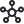

# Navigation bar

The main pages share a navigation bar at the bottom of the screen.

## Items

-  **Creations** - your creations.
-  **Devices** - scan for and manage your devices.
-  **Sequences** - manage reusable control sequences.
-  **More** - opens a menu with:
  -  **Input devices** - test connected game controllers and keyboards.
  -  **Settings** - open the application settings.
  -  **Help** - show the help of the current page.
  -  **About** - application information.

## See also

- [Creations](../creation-list/README.md)
- [Devices](../device-list/README.md)
- [Sequences](../sequence-list/README.md)
- [Input device tester](../input-device-tester/README.md)
